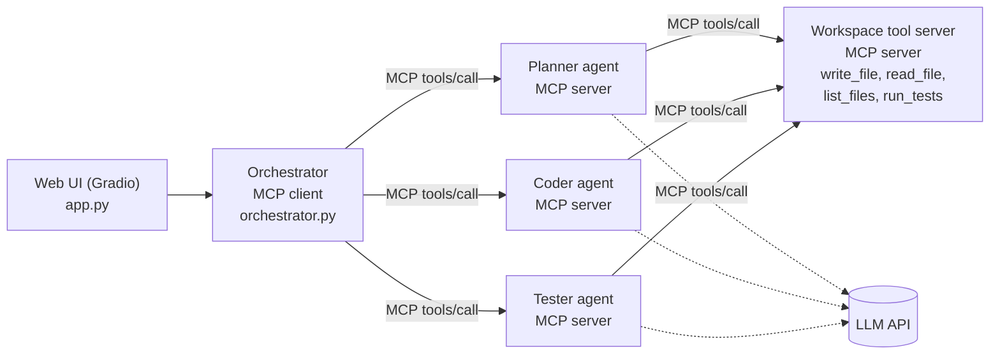

# AI Coder: a multi-agent system over MCP (BudgetMaster)

SWE 270P Final Project. Group members:

| Name | Student ID |
| --- | --- |
| Mouhamed Osman | 47083028 |
| Zhenyu Song | 15305920 |
| Jennifer Sun | 31687536 |

The AI Coder takes a **software description and its requirements** through a web UI and returns
the **executable application code** and the **executable test cases** for it. The work is done by
three LLM agents that communicate through the **Model Context Protocol (MCP)**, and the UI reports
the **LLM usage** (API calls and tokens) per agent.

Our selected software description is **BudgetMaster**; its description and our requirements are the
default input of the UI.

## Quick start

Requires Python 3.10 or newer.

```bash
python3 -m venv .venv
source .venv/bin/activate          # Windows: .venv\Scripts\activate
pip install -r requirements.txt
cp .env.example .env               # then put your API key into .env
python app.py                      # open http://127.0.0.1:7860
```

In the UI, press **Generate code and tests**. When the run finishes, the project is in
`generated/run-<timestamp>/` (and offered as a ZIP download):

```bash
cd generated/run-<timestamp>
streamlit run main.py              # run the generated application (opens in the browser)
python -m pytest                   # run the generated test cases
```

The LLM is any OpenAI-compatible chat-completions API. The defaults in `.env.example` target
DeepSeek (`deepseek-flash`).

## Architecture



- **Four MCP servers**: the three agents (`agents/planner.py`, `agents/coder.py`,
  `agents/tester.py`) and the workspace tool server (`tools/workspace_server.py`). All are built
  with the official MCP Python SDK and use the **stdio transport**, so each server is its own
  process.
- **MCP clients**: the orchestrator is a client of the three agents. Each agent is a server
  towards the orchestrator and at the same time a client of the workspace tool server.
- The orchestrator starts the three agent servers for a run. An agent starts a workspace server
  for the duration of each task it receives, scoped to the run's project directory.

### Agents, roles and tools

| Agent | Role | Tasks it offers (its MCP tools) | Workspace MCP tools it uses |
| --- | --- | --- | --- |
| **Planner** | Software architect: turns description and requirements into `DESIGN.md` (files, data model, exact public API, requirement mapping) | `create_design` | `write_file` (publishes `DESIGN.md`) |
| **Coder** | Developer: implements the design, repairs the code when tests fail | `implement`, `fix_code` | `list_files`, `read_file`, `write_file` |
| **Tester** | QA engineer: writes the pytest suite, runs it, reports the verdict | `write_tests`, `retest` | `list_files`, `read_file`, `write_file`, `run_tests` |

Role boundaries are enforced in code, not only in the prompts: the Coder cannot write test files
and the Tester cannot write application files (`may_write` in `agents/base.py`).

Inside an agent, the LLM runs in a tool-calling loop (`AgentRuntime.run_llm`): the agent discovers
the workspace tools with MCP `tools/list`, offers the ones allowed for its role to the LLM in
function-calling format, and executes every tool call the LLM makes through MCP `tools/call`,
feeding the result back until the LLM is done.

### Collaboration pattern

A pipeline with a test-driven feedback loop, coordinated by the orchestrator:

```
Planner.create_design -> Coder.implement -> Tester.write_tests
                              ^                    |
                              |    tests failed    v
                         Coder.fix_code  <->  Tester.retest      (at most MAX_FIX_ROUNDS = 2)
```

The agents communicate over MCP in three ways:

1. **Task hand-offs.** Every arrow above is an MCP tool call from the orchestrator to an agent.
   The Tester's failure report is passed to the Coder as the argument of `fix_code`, and the
   Coder's notes (what it changed, which test it believes is wrong) are passed to the Tester as the
   argument of `retest`.
2. **Shared workspace.** `DESIGN.md`, the source files and the tests are written and read only
   through the workspace MCP server, so each agent builds on what the previous one published.
3. **Progress notifications.** While working, an agent sends MCP progress notifications to the
   orchestrator. They form the live activity log in the UI.

The orchestrator is plain code and makes no LLM calls. The pass/fail verdict always comes from a
real `run_tests` result, never from what an LLM claims.

## LLM usage tracking

- Every LLM request in the system goes through `LLMClient.chat()` in `llm.py`. After each request
  it reads the `usage` field of the API response and adds the call and its prompt, completion and
  total tokens to a `UsageTracker`.
- Each agent task has its own tracker and returns its usage to the orchestrator inside the MCP
  tool result (also when the task fails).
- The orchestrator keeps one usage record per task. The UI shows them in the **LLM usage** tab,
  **by agent** (with a TOTAL row) and **by pipeline step**, and shows running totals in the status
  line. The activity log also shows the tokens of every single LLM call.

Design decisions that keep the usage low:

- Coordination costs no LLM calls (the orchestrator is deterministic); the Planner needs one call.
- Agents load their context (design, current files) through MCP from code, instead of letting the
  LLM read files one tool call at a time.
- `retest` runs the tests first and only consults the LLM if they still fail.
- Test output is shortened (`--tb=short`, last 6000 characters) before it enters a prompt.
- The number of LLM calls per task (`AGENT_MAX_STEPS`) and of fix rounds (`MAX_FIX_ROUNDS`) is capped.

A run without fix rounds takes about 6 LLM calls: 1 Planner, 2 Coder, 3 Tester.

## User interface

`app.py` (Gradio) has two inputs, **Software description** and **Requirements**, and shows:

| Area | Content |
| --- | --- |
| Agent activity | Live log of the MCP calls between orchestrator, agents and tools, and of each LLM call |
| Generated code | The application source files, and the ZIP download of the project |
| Test cases | The generated pytest files |
| Test results | Verdict and pytest output of the latest test run |
| LLM usage | API calls and tokens by agent and by pipeline step |
| Design | The Planner's `DESIGN.md` |

## BudgetMaster: description and requirements

**Description** (from the sign-up sheet): BudgetMaster is a budgeting software application that
helps individuals effectively manage their finances by providing comprehensive budgeting features.
It allows users to input their income and expenses, categorize them, and set budget goals. The
software provides visual representations of budget breakdowns and generates reports to track
spending patterns. With BudgetMaster, users can make informed financial decisions and stay on
track to achieve their financial goals.

**Requirements defined by our group** (`budgetmaster_spec.py`):

| ID | Requirement |
| --- | --- |
| R1 | Income: record an income entry with an amount, a source and a date (YYYY-MM-DD). |
| R2 | Expenses: record an expense entry with an amount, a category, a date and an optional note. |
| R3 | Categories: every expense belongs to a category; default categories Housing, Food, Transportation, Utilities, Entertainment, Healthcare and Other; the user can add custom categories. |
| R4 | Budget goals: set and update a monthly budget limit for each category. |
| R5 | Budget breakdown: for a chosen month, show per category the amount spent, the limit, the remaining amount and the percentage used, and flag categories that are over budget. A category without a budget limit shows its amount spent and "no limit"; it has no remaining amount or percentage and is never flagged. |
| R6 | Visual representation: show the breakdown of a chosen month as charts: a bar chart comparing the amount spent with the budget limit of each category, and a chart of each category's share of the month's total spending. |
| R7 | Monthly report: total income, total expenses, net savings and the three categories with the highest spending. |
| R8 | Spending pattern: show the total expenses of every recorded month in chronological order as a chart. |
| R9 | Validation: reject non-positive amounts, invalid dates, unknown categories and negative budget limits with a clear error message. |
| R10 | Persistence: save all data to a JSON file and load it again on restart. |
| R11 | Interface: a graphical user interface in the web browser gives access to all features, with forms for entering data and tables and charts for the results. |

## Project structure

```
app.py                     Web UI (Gradio); starts a run and renders its progress
orchestrator.py            MCP client; the Planner -> Coder -> Tester pipeline and the fix loop
llm.py                     OpenAI-compatible LLM client with usage tracking
budgetmaster_spec.py       BudgetMaster description and requirements (default UI input)
agents/
  base.py                  Shared agent runtime: LLM tool-calling loop over MCP tools
  planner.py               Planner agent (MCP server)
  coder.py                 Coder agent (MCP server)
  tester.py                Tester agent (MCP server)
tools/
  workspace_server.py      Workspace MCP server: write_file, read_file, list_files, run_tests
generated/                 Output: one folder (and ZIP) per run; not committed
```

## Configuration

Set in `.env` (see `.env.example`):

| Variable | Default | Meaning |
| --- | --- | --- |
| `LLM_API_KEY` | (required) | API key of the LLM provider |
| `LLM_BASE_URL` | `https://api.deepseek.com` | Base URL of the OpenAI-compatible API |
| `LLM_MODEL` | `deepseek-flash` | Model name |
| `LLM_THINKING` | unset | DeepSeek only: `disabled` or `enabled` |
| `LLM_MAX_TOKENS` | `16384` | Output-token limit of one LLM call |
| `AGENT_MAX_STEPS` | `10` | LLM calls one agent may make per task |
| `MAX_FIX_ROUNDS` | `2` | Coder and Tester repair rounds after failing tests |

## Notes

- The generated projects follow fixed conventions (`PROJECT_CONVENTIONS` in `agents/base.py`):
  a Streamlit web app with `main.py` as the entry point, the application logic in separate
  modules without any UI code, and pytest tests. The tests cover the logic modules and include a
  smoke test that renders the user interface with Streamlit's `AppTest`.
- `run_tests` executes the generated code on the local machine, without a sandbox.
- LLM output varies between runs, so the generated code, the tests and the usage numbers differ
  from run to run.
